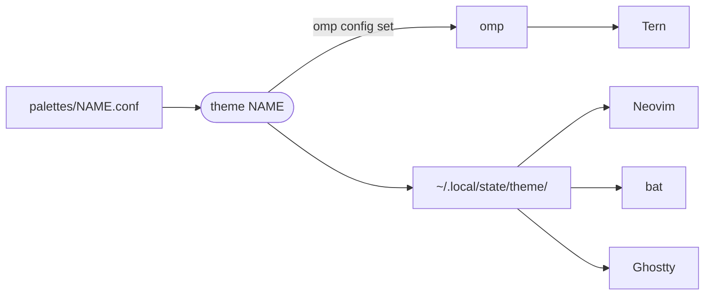

<a name="top"></a>
<div align="center">

# ~/.dotfiles

**My Mac, as code.** Tern as terminal and multiplexer, Neovim and zsh inside
it, and the omp agent setup I work with every day. One script sets up a fresh
machine, and one command switches the colour scheme everywhere.

<a href="#install"></a>
<a href="#tern"></a>
<a href="https://www.gnu.org/software/stow/"></a>
<a href="#themes"></a>

[**Install**](#install) &nbsp;·&nbsp;
[**What's inside**](#whats-inside) &nbsp;·&nbsp;
[**Cheat sheet**](#cheat-sheet) &nbsp;·&nbsp;
[**Themes**](#themes) &nbsp;·&nbsp;
[**Maintenance**](#maintenance) &nbsp;·&nbsp;
[**Secrets**](#secrets)

</div>

> [!WARNING]
> These are my personal configs. Read `setup_mac.sh` before you run it: among
> other things it writes `/etc/pam.d/sudo_local` to turn on Touch ID for `sudo`.

<table width="100%">
  <tr>
    <td width="33%" valign="top"><h3>🖥️ Tern</h3>Terminal and multiplexer in one: vertical tabs, sessions kept alive by its daemon, <kbd>Ctrl</kbd>+<kbd>B</kbd> pane keys.</td>
    <td width="34%" valign="top"><h3>🧩 Tern plugins</h3>Luau plugins: a Jira sprint sidebar, dwm-style tiling, GitHub Actions status, file links that open in Neovim.</td>
    <td width="33%" valign="top"><h3>🤖 omp</h3>Coding-agent config: Atlassian and Notion MCP, Jira <code>/implement</code>, an ideas store, a query cache.</td>
  </tr>
  <tr>
    <td width="33%" valign="top"><h3>✍️ Editor</h3><b>Neovim</b> on lazy.nvim, native LSP for TypeScript, Go, Python, Lua, Docker, YAML and more, blink completion, snacks.</td>
    <td width="34%" valign="top"><h3>🐚 Shell</h3><b>zsh</b> with vi keys, the pure prompt, fzf history, zoxide as <code>cd</code> and an <code>rm</code> that moves files to the Trash.</td>
    <td width="33%" valign="top"><h3>🎨 Themes</h3>20 colour schemes. <code>theme</code> switches Tern, omp, Neovim, bat and Ghostty in one go.</td>
  </tr>
</table>

## Install

Tern is not in Homebrew, so install it by hand. Then, on a fresh Mac:

```sh
git clone https://github.com/Notaduck/.dotfiles.git ~/.dotfiles
cd ~/.dotfiles
./setup_mac.sh
```

Open a new shell when it finishes.

<details>
<summary><b>What <code>setup_mac.sh</code> does</b></summary>

1. Installs Homebrew, or updates it.
2. Runs `brew bundle` on the [`Brewfile`](Brewfile) (omp comes from the `can1357/tap` tap).
3. Stows every package in `STOW_PACKAGES`.
4. Copies `tern-settings.json` into place if Tern has no settings yet.
5. Turns on Touch ID for `sudo` and asks for your password once.
6. Turns off macOS press-and-hold in Tern, so held keys repeat.
7. Applies the default colour scheme with `theme catppuccin-mocha`.
8. Adds the asdf plugins listed in `~/.tool-versions` and installs those versions.

</details>

> [!NOTE]
> Stow will not overwrite real files. If the Mac already has a `~/.zshrc` or
> similar, move it aside (or merge it into the package) and run the script again.

## What's inside

Each top-level directory is a [stow](https://www.gnu.org/software/stow/)
package that mirrors `$HOME`: `zsh/.zshrc` becomes `~/.zshrc`, and
`nvim/.config/nvim` becomes `~/.config/nvim`.

| Package | What it is | Links into |
| :--- | :--- | :--- |
| [`tern`](tern) | Tern plugins and themes | `~/Library/Application Support/Tern/…`, `~/.local/bin/tern-plugin-audit` |
| [`omp`](omp) | omp agent config and extensions | `~/.omp/agent/…`, `~/.local/bin/{omp-sessions,ideas}` |
| [`nvim`](nvim/.config/nvim) | Neovim | `~/.config/nvim` |
| [`zsh`](zsh) | Shell config and `PATH` | `~/.zshrc`, `~/.zprofile` |
| [`theme`](theme) | The `theme` switcher and its palettes | `~/.local/bin/theme`, `~/.config/theme/palettes` |
| [`asdf`](asdf) | Global Node and Lua versions | `~/.tool-versions`, `~/.default-npm-packages` |
| [`bat`](bat/.config/bat/themes) | Catppuccin themes for bat | `~/.config/bat/themes` |
| [`btop`](btop/.config/btop/btop.conf) | System monitor | `~/.config/btop/btop.conf` |
| [`ghostty`](ghostty/.config/ghostty) | Backup terminal | `~/.config/ghostty` |

Also in the repo root: the [`Brewfile`](Brewfile), [`setup_mac.sh`](setup_mac.sh),
`tern-settings.json` (see [Tern settings](#tern-settings)) and `.stowrc`, which
sets the target to `~` and ignores `.DS_Store`, so a plain `stow <pkg>` works
from the repo root.

<a name="tern"></a>
<details>
<summary><b>🧩 Tern plugins</b></summary>

| Plugin | What it does |
| :--- | :--- |
| `jira-sprint` | Sidebar with your open-sprint Jira issues, the `~/ideas` store and omp sessions to resume. Its Implement button opens a worktree and starts omp on the issue |
| `tiling` | dwm-style per-tab layouts: tile, monocle, fibonacci spiral, dwindle and grid |
| `pane-keys` | Pane focus on <kbd>Ctrl</kbd>+<kbd>B</kbd> <kbd>h</kbd><kbd>j</kbd><kbd>k</kbd><kbd>l</kbd>, a move-pane mode and stronger dimming of unfocused panes |
| `gh-actions` | Running GitHub Actions workflows for the repo in the focused terminal |
| `nvim-open` | Clicked file links open in Neovim beside the pane |
| `omp-projects` | Claude-Desktop-style projects: one session per project, every new tab a chat in that folder |
| `sidebar-session` | CSS only. In the Tiles layout with vertical tabs it moves the avatar and session switcher into the sidebar and hides the titlebar's + button |

Plus the notebook-paper theme and `tern-plugin-audit`, which reports what
changed in Tern's plugin API since the plugins were last checked.

Plugin data stays on the machine and is gitignored:
`jira-sprint` reads site, email and repos from
`plugin-data/jira-sprint/jira.json` (written with placeholders on first run),
and `omp-projects` reads `plugin-data/omp-projects/projects.json`.

**Overseer** is installed separately with
`tern plugin install github.com/mmnavarr/overseer` (it needs `worktrunk`) and
patched by hand so ticket links open Jira: `ticketFor` in `window.luau` builds
`https://<site>.atlassian.net/browse/<KEY>`, and "Linear" becomes "Jira" in
`view.luau` and `visualize.luau`. Updating Overseer drops the patch.

</details>

<details>
<summary><b>🤖 omp extensions</b></summary>

Config: `config.yml`, `models.yml` (local Ollama models), `mcp.json` (Atlassian
and Notion) and `APPEND_SYSTEM.md`, plus the notebook themes. Skills are not
tracked.

| Extension | What it does |
| :--- | :--- |
| `implement` | `/implement <KEY>` reads a Jira issue (and a linked idea) and writes a plan for approval |
| `session-title` | Titles the chat `[KEY] Summary` after the Jira issue it works on |
| `ideas` | `/idea save`, `/idea update` and friends: park plans and scratchpads in `~/ideas` and load them later |
| `plan-panel` | The agent's todo list in a panel on the left. <kbd>Ctrl</kbd>+<kbd>\\</kbd> toggles it |
| `scheduled-prompt` | Runs a prompt in the chat at a set time; `/schedule` manages them |
| `turn-times` | A dim `↳ sent 14:02:11 · replied 14:03:40 · 1m29s` row after each run, never sent to the model |
| `query-cache` | Keeps read-only AWS CLI and MCP results for 30 days in `~/.cache/omp/query-cache.sqlite`; the agent looks them up with `query_cache` and never gets an answer from it automatically |

Two scripts in `~/.local/bin` wrap them for GUI apps such as Tern:
`omp-sessions` finds and resumes sessions, and `ideas` is the ideas-store CLI.

</details>

<details>
<summary><b>🐚 zsh</b></summary>

- `.zprofile` runs `brew shellenv` and builds `PATH`, asdf shims first.
- Vi keys with an instant switch to normal mode.
- The pure prompt, zsh-autosuggestions and fast-syntax-highlighting, all from Homebrew.
- One history file shared by every tab and pane. <kbd>Ctrl</kbd>+<kbd>R</kbd> searches all of it; <kbd>↑</kbd> stays local to the shell.
- direnv, plus zoxide taking over `cd`.
- Warns when a misnamed `.tool-versions` file would be ignored by asdf.

</details>

## Cheat sheet

### Tern

Every binding starts with the <kbd>Ctrl</kbd>+<kbd>B</kbd> prefix.

| Keys | Action |
| :--- | :--- |
| <kbd>h</kbd> <kbd>j</kbd> <kbd>k</kbd> <kbd>l</kbd> | Focus pane left / down / up / right |
| <kbd>v</kbd> | Move mode: <kbd>h</kbd> <kbd>j</kbd> <kbd>k</kbd> <kbd>l</kbd> move the pane, <kbd>Esc</kbd> leaves |
| <kbd>t</kbd> / <kbd>m</kbd> / <kbd>f</kbd> / <kbd>d</kbd> / <kbd>=</kbd> | Tile / monocle / spiral / dwindle / grid layout |
| <kbd>Space</kbd> / <kbd>Tab</kbd> | Next / previous layout |
| <kbd>Shift</kbd>+<kbd>L</kbd> | Choose a layout |
| <kbd>o</kbd> | Stop tiling this tab |
| <kbd>Enter</kbd> | Make the focused pane the master |
| <kbd>]</kbd> / <kbd>[</kbd> | Grow / shrink the master |
| <kbd>i</kbd> | Toggle the Work sidebar (Jira sprint, ideas, sessions) |
| <kbd>Shift</kbd>+<kbd>I</kbd> | Open the Work sidebar on Ideas |
| <kbd>s</kbd> | New chat in a project |

### Shell

| Command | Does |
| :--- | :--- |
| <kbd>Ctrl</kbd>+<kbd>R</kbd> | Search all history: <kbd>Enter</kbd> runs it, <kbd>Tab</kbd> puts it on the prompt to edit |
| `cd foo` | Enters `./foo`, otherwise jumps to the best zoxide match. `cdi` picks one interactively |
| `rm file` | Moves to the Trash. `command rm` really deletes |
| `secret NAME` | Prints a secret from the Keychain (see [Secrets](#secrets)) |
| `ghcpr 123` | Checks out PR 123 in a worktree and opens it in a Tern split beside the pane |
| `theme` | Colour scheme picker (see [Themes](#themes)) |
| `vim`, `gl` | `nvim`, `glab` |

## Themes

Run `theme` for an fzf picker: move through the list, see each palette on the
right, and press <kbd>Enter</kbd> to apply it everywhere and reload what is
running. The default is **Catppuccin Mocha**.

```sh
theme catppuccin-mocha   # switch without the picker
theme list               # all themes
theme current            # the active one
theme toggle             # the next one in the list
theme preview nord       # what the picker shows for one theme
```

Shipped: **Catppuccin** (latte, frappe, macchiato, mocha), **Rose Pine** (main,
moon, dawn), **Tokyo Night** (night, storm, moon, day), **Kanagawa** (wave,
dragon, lotus), **Gruvbox** (dark, light), **Everforest** (dark, light),
**Nord** and **Dracula**.



<details>
<summary><b>How it works</b></summary>

Each theme is one file in `theme/.config/theme/palettes/<name>.conf` made of
`set -g @thm_<key> "value"` lines: the colours as roles (`@thm_bg`,
`@thm_accent`, …) plus the name each app uses (`@thm_nvim`, `@thm_ghostty`,
`@thm_bat`, `@thm_omp`, `@thm_mode`).

- omp gets the theme in both `theme.dark` and `theme.light` via
  `omp config set`, so the tracked `omp/.omp/agent/config.yml` changes when you
  switch away from the default.
- Tern follows omp's theme as long as `theme_dark` and `theme_light` are absent
  from its `settings.json`. Setting a theme in Tern pins it again.
- omp has no Kanagawa or Rose Pine Dawn theme, so those map to the nearest
  built-in (`dark-tokyo-night`, `dark-gruvbox`, `light-gruvbox`, `light-opal`).
- The active choice goes to `~/.local/state/theme/`, which is not tracked.
  Neovim reads `current` in `lua/config/theme.lua` (lualine uses the palette
  colours), `.zshrc` exports `BAT_THEME` from `bat`, and Ghostty includes the
  `ghostty` file.
- Reloading Ghostty clicks its "Reload Configuration" menu item, which needs
  Accessibility access for the terminal. Without it, press
  <kbd>Cmd</kbd>+<kbd>Shift</kbd>+<kbd>,</kbd>.

</details>

<details>
<summary><b>Adding a theme</b></summary>

1. Copy a palette file and fill in the colours and app names:
   - omp and Tern: a name from omp's `/settings` → Appearance, e.g. `dark-catppuccin`.
   - bat: a name from `bat --list-themes` (`ansi` follows the terminal colours).
   - Ghostty: a name from `ghostty +list-themes`, or a file in `ghostty/.config/ghostty/themes/`.
2. If the Neovim colorscheme is a new plugin, add a spec in
   `nvim/.config/nvim/lua/colorschemes/`.

</details>

## Maintenance

Configs are edited in place. `~/.zshrc` and the other targets are symlinks into
this repo, so every change shows up in `git status` here.

```sh
stow nvim        # link a package
stow -R nvim     # relink after adding or removing files in it
stow -D nvim     # unlink
```

### Adding a package

1. Create `<name>/` mirroring the path under `$HOME`, e.g.
   `lazygit/.config/lazygit/config.yml`.
2. Move the existing config into it and run `stow <name>`.
3. Add `<name>` to `STOW_PACKAGES` in `setup_mac.sh` and to the
   [package table](#whats-inside).
4. If it needs software, add it to the `Brewfile`.

### Checking for drift

Some apps replace a symlink with a real file when they save. A dry run lists
every target that is no longer a link:

```sh
cd ~/.dotfiles && for p in */; do stow -n -R "${p%/}"; done 2>&1 | grep -v 'simulation mode'
```

No output means everything is linked. For a conflict, diff the real file
against the repo copy, merge, delete the real file and run `stow -R <pkg>`.

<a name="tern-settings"></a>
### Tern settings

Tern saves `settings.json` by replacing the file, which would break a stow
link, so `setup_mac.sh` copies `tern-settings.json` into place once instead.
Copy changes back by hand:

```sh
cp ~/Library/Application\ Support/Tern/settings.json ~/.dotfiles/tern-settings.json
```

## Secrets

Nothing secret goes in this repo. Secrets live in the login Keychain and are
read on demand, so they are not exported to every process:

```sh
STRIPE_API_KEY=$(secret STRIPE_CLI_READ_ONLY_KEY) stripe ...   # read one
security add-generic-password -U -a "$USER" -s NAME -w          # add or replace (prompts)
```

Other machine-specific values go in `~/.zshenv`, which is not tracked.

<div align="center">

[↑ Back to the top](#top)

</div>
